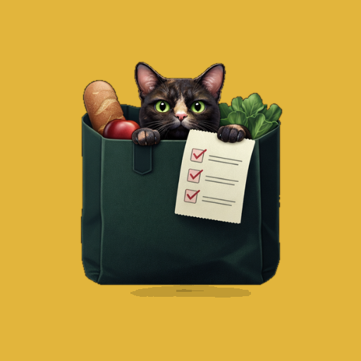

<p align="center">
  
</p>

<h1 align="center">Mercheck</h1>

<p align="center">
  A calm, glassy, mobile-first home for every checklist you keep in your head.
</p>

## What it's for

Most list apps assume you only need one kind of list. Mercheck doesn't — it's a home for **all** of them, side by side, each one just a tap away:

- 🛒 **The weekly supermarket run** — check items off as you drop them in the cart
- 🏠 **Things the house needs** — light bulbs, batteries, whatever's run out
- ✈️ **Packing for a trip** — never re-derive "did I bring a charger?" at the airport again
- 🐾 **Supplies for your pets** — food, litter, meds, on their own list
- 📋 **Literally anything else** — Mercheck doesn't care what's on the list, it just makes it fast to capture, check off, and come back to

The value isn't any single list — it's not having to juggle five different notes apps, or a sticky note that gets lost, to hold them all. Pin the lists you use constantly, tuck away the ones you don't, and everything is right there next time you open the app.

## How it works

- **Multiple lists, one place** — create as many as you need, named however you like
- **Pin your regulars** — keep the lists you touch weekly at the top
- **Inline editing** — rename lists and items in place, no separate edit screen
- **Installable PWA** — add it to your home screen and it opens like a native app, icon and all
- **Accounts and sync** — sign in and your lists follow you to every device; reopening the app picks up changes made elsewhere
- **Voice shortcuts** — an API for phone shortcuts (e.g. Siri) to mark an item as needed or add it, by voice

## Stack

- **React 18** + **Vite 6** for the app shell and build
- **Tailwind CSS** for styling
- **Framer Motion** for the list/item animations
- **Lucide React** for icons
- **vite-plugin-pwa** — installable PWA with an auto-updating service worker and manifest (standalone display, portrait orientation)
- **Server:** Node 24 + Express + TypeScript, data in SQLite (Node's built-in `node:sqlite`), serving both the API and the built app
- **Accounts:** a separate shared account service (users, sessions, per-user API keys) reached over a private network; Mercheck itself stores no passwords

## Project structure

```
src/
  Root.jsx             — sign-in gate: loads the lists, imports old browser data once
  App.jsx              — the lists carousel
  components/          — ActionMenu, Dock, InlineEdit, ItemRow, ListCard, Login, SettingsMenu, Toast
  lib/                  — api, ids, settings, storage, useDismiss, useLists
server/
  src/index.ts          — HTTP server: security headers, API, static app
  src/routes.ts         — sign-in, lists, voice endpoints
  src/store.ts          — lists and items per user (SQLite)
  src/siri.ts           — matching spoken text to items
  src/auth.ts           — client for the account service
  test/                 — node:test suites
```

## How the app talks to the server

Every change shows at once and is sent as one small operation (`POST /api/ops`, e.g. `{ type: "setItemChecked", listId, itemId, checked }`); operations go out one at a time and the server answers with the full state. `GET /api/state` returns all of the user's lists and is reloaded whenever the app comes back to the foreground.

Lists saved in a browser by earlier versions (local storage) are imported once, the first time an account with no lists signs in on that browser (`POST /api/import`). The old copy is left in place as a backup.

## Voice shortcuts

Both routes take a per-user API key from the account service in `Authorization: Bearer <key>`.

- `POST /api/siri/lookup` `{ text }` — never changes anything. Understands `"milk"`, `"add the milk"` or `"milk en <list name>"` (Spanish phrasing), and answers `{ speak, options: [{ label, option }], menu: { label: option } }` (`menu` is the same options keyed by label, so a shortcut can show the labels and look up the chosen one):
  - one match → one option to mark it as needed (the shortcut asks yes/no),
  - several matches → one option per match plus "create it new" options (the shortcut shows a menu),
  - no match → one "create in <list>" option per list (or just the named list),
  - already needed → no options; `speak` says so.
- `POST /api/siri/apply` `{ option }` — carries out the chosen option and answers `{ speak }`.

Matching ignores case and accents, accepts part of a name ("milk" finds "Semi-skimmed milk") and simple plurals.

**Plain-text conversation** (for a minimal shortcut made of web addresses only, no headers or body). The key goes in `?key=` and every answer is a `text/plain` sentence, errors included (`401` for a bad key).

- `GET /api/siri/say?key=…&text=…` — looks the item up like `lookup`. One option: answers the yes/no question. Several: the question followed by a numbered list ("1: … 2: …"). Nothing to do: just says why.
- `GET /api/siri/answer?key=…&text=…` — "sí"/"no", a number ("el dos", "3"), or part of a choice's name ("batido", a list name) carries it out and answers what was done. The open question lasts 10 minutes.

## Development

```bash
npm install
cd server && npm install && cp .env.example .env   # fill in the account service URL and token
npm run dev          # in server/: API on port 4480
npm run dev          # in the project root: the app, proxying /api to port 4480
cd server && npm test
```

Set `COOKIE_SECURE=false` in `server/.env` when testing over plain http.

## Deployment

A multi-stage `Dockerfile` builds the app and the server into one Node image that serves both on port `4480`.

Every push to `main` builds the image with GitHub Actions and publishes it to GitHub Container Registry. `docker-compose.yml` runs that prebuilt image with:

- `server/.env` (from `server/.env.example`): the account service URL and its service token,
- `./data` mounted for the SQLite database,
- the external Docker network `accounts`, created by the account service.

```bash
docker compose pull
docker compose up -d
```

The app is then served on port `1102` (change the left side of `ports` to use another). Pair it with a container auto-updater such as Watchtower to pick up new images automatically; changes to the compose file itself still need `docker compose up -d`.
